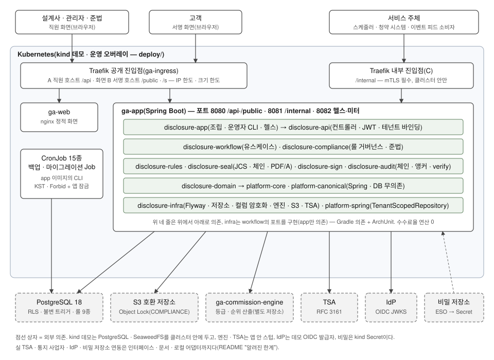

# ga-disclosure

[한국어](README.md) | **English**

A multi-tenant workflow service that lets an agent at a large GA (general insurance agency with 500+ affiliated agents) complete, in one flow before a contract is signed, **comparison table of same/similar products → sales commission grade and rank → recommendation reason → confirmation (signatures) by customer, agent and manager → immutable retention and audit**. Grades and ranks are computed by a separate repository, `ga-commission-engine`; this repository only receives the result as a snapshot and validates, displays and retains it. A sealed confirmation is immutable, signatures are bound to the document hash, and every piece of evidence can be re-checked with an independent verification command.

**Regulatory background**: from 2026-07-01, large GAs must additionally explain, during the contracting process, the sales commission grade (5 levels) and rank (rank 1 is the lowest) of similar insurance products, together with the reason for the recommendation — [Financial Services Commission press release (2026-06-30, Korean)](https://fsc.go.kr/no010101/87217), based on the [Regulation on Supervision of Insurance Business (Korean)](https://www.law.go.kr/행정규칙/보험업감독규정) (amendment adopted by the FSC on 2026-01-14).

> **Disclaimer** — This is a learning and portfolio repository. The regulatory content is an illustrative summary based on public materials; the actual requirements are those in the original texts of the Regulation on Supervision of Insurance Business, its enforcement rules, the association's standard forms and official interpretations. Numbers such as the numbering scheme, deadlines and retention periods are fictitious example values. This system does not claim to satisfy statutory requirements.

> **Language note** — The design document, Phase records, operations documents and the UI are written in Korean. This page is an English translation of [`README.md`](README.md); if the two differ, the Korean version is the reference.

## Known limitations and open items

- **The original of the association's standard confirmation form has not been obtained** (§14 #2) — form labels are generic Korean labels, and nothing is labelled "association standard".
- **"Collection rate" has no regulatory definition** (§14 #17) — the collection rate shown on screens and in reports is an internal metric (its formula is a closed list in the rules).
- **Not integrated with a real TSA, notification provider, IdP or secret store** — the work stops at interfaces, operations documents and local adapters (stub TSA, console notifications, demo OIDC, file/kind secrets). The shape of real TSA responses is covered only by an opt-in contract test.
- **The mTLS subject forwarding format is unspecified** (§14 #23) — with the production overlay as-is, the certificate-subject matching paths of the gate and contract linking return 404 (the kind demo uses a demo profile with matching turned off).
- **Public signing limits are counted per replica** — effective limit = rule value × number of app replicas; IP limit = 30 × number of ingress replicas ([`ingress.md`](docs/operations/ingress.md)).
- **The public signing response floor (padding) is a configuration value**; an appropriate value at scale has not been measured.
- **The first-run time of the tour has not been measured** — the 6.4 minutes in the reproduction log come from a machine with warm caches (toolchain, images, node image).
- The final status of the 23 open items, such as the actor and reassignment for corrections (§14 #20) and merging duplicate pseudonyms (#22), is in the table at the top of [design document §14](docs/설계서.md#14-미결정-사항-구현-전-확인-전부-파라미터어댑터로-흡수).

## Numbers (from CI)

| Phase | Scope | Tests (CI, 0 failed / 0 skipped) | Rule-violation injections | E2E | CI run |
|---|---|---:|---:|---:|---|
| 0 | Skeleton, shared platform | 4,869 | 16 | — | [36549053160](https://github.com/hjryoo-ai/ga-disclosure/actions/runs/36549053160) |
| 1 | Rules and form data | 7,138 | 10 | — | [36554847957](https://github.com/hjryoo-ai/ga-disclosure/actions/runs/36554847957) |
| 2 | Catalog, customer reference, column encryption | 7,281 | 12 | — | [36701264864](https://github.com/hjryoo-ai/ga-disclosure/actions/runs/36701264864) |
| 3A | Workflow core, engine snapshot | 9,268 | 11 | — | [36712325175](https://github.com/hjryoo-ai/ga-disclosure/actions/runs/36712325175) |
| 3B | Sealing, PDF/A, storage Object Lock | 10,790 | 22 | — | [36856909677](https://github.com/hjryoo-ai/ga-disclosure/actions/runs/36856909677) |
| 4 | Signatures, evidence package | 11,733 | 56 | — | [37063019897](https://github.com/hjryoo-ai/ga-disclosure/actions/runs/37063019897) |
| 5 | Anchoring, TSA, verification, destruction | 12,037 | 69 | — | [37099922622](https://github.com/hjryoo-ai/ga-disclosure/actions/runs/37099922622) |
| 6A | REST API, jobs, idempotency | 12,204 | 105 | — | [37786410851](https://github.com/hjryoo-ai/ga-disclosure/actions/runs/37786410851) |
| 6B | Compliance queue, contract linking, gate | 13,642 | 151 | — | [37926046428](https://github.com/hjryoo-ai/ga-disclosure/actions/runs/37926046428) |
| 7 | UI, E2E | 13,689 + 24 UI unit | 28 | 12 | [37968091134](https://github.com/hjryoo-ai/ga-disclosure/actions/runs/37968091134) |
| 8 | Deployment, operations, key rotation, backup, restore | 13,835 + 47 deploy lint + 5 image + 27 UI unit | 63 | 12 + 12 against kind | [38517344797](https://github.com/hjryoo-ai/ga-disclosure/actions/runs/38517344797) |

Test counts were checked against each run's `test-reports` artifact (the sum of the Gradle reports). Injections are records of deliberately planting a violation for each rule test (ArchUnit, SQL scan, trigger, lint), confirming the failure and reverting it — the numbers are counted from the injection table in each Phase report (they are not in the CI artifacts). **The unit of counting is one injection ID** (a table row with several IDs is counted per ID — e.g. Phase 7's W3a and W3b count as 2, which gives 28 instead of the 27 in the report body; 6A and 6B are counted the same way). Phases 0 and 1 have no IDs, so each injected violation counts as 1 (Phase 0: architecture 7 + SQL scan 4 + trigger/constraint/RLS 4 + jqwik 1).

## Architecture



Where each rule is enforced in the code (and where it is not): [`docs/ARCHITECTURE.md`](docs/ARCHITECTURE.md). The evidence lifecycle of a single confirmation: [`docs/EVIDENCE.md`](docs/EVIDENCE.md). Decisions that were reversed or turned out wrong: [`docs/DECISIONS.md`](docs/DECISIONS.md).

## 15-minute tour (kind)

Deploy to an empty kind cluster → demo data → UI → `verify tenant`. It does not touch anything else in your environment (compose volumes, other clusters), and at the end `down` deletes only this cluster and its secrets directory.

**Requirements**: Docker (around 8 GB of memory), JDK 17 or later (to run Gradle — Gradle downloads the Java 25 toolchain and the Node used for the UI build), `curl`, `jq`, `openssl` (LibreSSL works too), and Chrome to view the UI. Gradle downloads the pinned versions of kind, kubectl and kubeconform from `deploy/tools.lock` into `build/tools` (no global install). macOS and Linux. Run from the repository root.

**Time**: on a machine with warm caches, all of the commands below took about 6.4 minutes (reproduced 2026-10-10 — see "Reproduction log" below). The first run takes longer because it downloads the Java toolchain, dependencies and node image and builds the images (not measured).

```bash
git clone https://github.com/hjryoo-ai/ga-disclosure && cd ga-disclosure
C=ga-tour-$(date +%s)                 # cluster name (must start with ga-)
deploy/scripts/kind.sh up "$C"        # fetch tools · cluster · build and load images (the first run is slow because of the build)
deploy/scripts/kind.sh deploy "$C"    # generate secrets (outside the repo, ~/.ga-disclosure/kind/$C) → apply → migration Job → rollout
deploy/scripts/kind.sh smoke "$C"     # assert the three ingresses, mTLS, limits, NetworkPolicy (must be 0 failures)
deploy/scripts/kind.sh seed "$C"      # seed three demo tenants → in-cluster VERIFY_TENANT: DEMO1 · DEMO2 · DEMO3 MATCH
deploy/scripts/kind.sh browse "$C"    # print a Chrome command line for the UI — copy and run it (separate profile, no hosts or trust store changes)
deploy/scripts/kind.sh verify "$C"    # run again whatever you did in the UI: exit 1 unless every tenant is MATCH
deploy/scripts/kind.sh down "$C"      # deletes only the cluster and ~/.ga-disclosure/kind/$C — images (ga-disclosure/*:dev, kindest/node), the Docker network kind and the clone's build/ remain
```

The hash in `VERIFY_TENANT … MATCH findings=0 sha256=…` is the hash of that run's verification **report** (which includes the run time), so it differs on every run — what must stay the same is `MATCH findings=0`.

**UI** (staff host `https://staff.ga.example.invalid:18443/staff`): "데모 로그인" (demo login) → choose an account in the new window (pop-ups must be allowed). Roles come from the server-side `identity_link`, not from the token.

| Account | Role | Things to try |
|---|---|---|
| `DEMO1 · demo-agent` | Agent | New confirmation → products to compare → grade and rank → recommendation reason (pick from the rule vocabulary, write the explanation yourself) → validate → seal → signing session "현장 터치패드" (on-site touchpad) → signing window on the signing host |
| `DEMO1 · demo-manager` | Manager | List → check flags on the detail page → manager confirmation (completes the confirmation if it is the last signature) |
| `DEMO1 · demo-compliance` | Compliance | Compliance flags (filter, assign, resolve), legal hold (release by `demo-compliance-2` — four-eyes), jobs (retention recalculation dry-run), collection rate |

The same flow, plus resolving a `CHAIN_BROKEN` (an incident in which one audit row is briefly altered so that verification finds it), is run as 12 desktop and mobile cases across ingresses A, B and C by `./gradlew :disclosure-web:e2eKind -Pkind.cluster="$C"` (the task runs the preparation step `kind.sh e2e-prep` itself and, on first use, downloads Playwright Chromium; the closing `E2E DOWN` only cleans up the test processes and leaves the cluster in place). The CI job `kind` additionally runs six kinds of backup, restore and key rotation scenarios — [`docs/operations/`](docs/operations/).

### Reproduction log

| Who | When | Looked at | Result / where it got stuck |
|---|---|---|---|
| A separate agent with no context (a new session that was given none of this work's context) | 2026-10-10 | A fresh clone of `work/phase-8` `9549c9d` + this README only | **Reached MATCH for all three tenants without getting stuck.** up 63 s · deploy 126 s · smoke 20 s (0 failures) · seed 165 s (`SEED_LINES 44`) · verify 11 s · down 1 s (warm cache, macOS arm64 · Docker 7.75 GiB). For the UI, only up to loading the staff page in headless Chrome (0 TLS errors) — everything after login is for a human; e2eKind 12/12 instead. The 6 places where it had to guess (e2e-prep order, the VERIFY hash changing per run, first-run time, what down leaves behind, Node, the clone/cd line) were reflected in the README in that revision |
| A human | — | — | Whenever convenient, separately from the acceptance review (PR comment + this table) |

## Document index

The documents below are written in Korean.

| Document | Contents |
|---|---|
| [`docs/설계서.md`](docs/설계서.md) | Design document (the reference) — premises (§0), data model, state machine, API, security, §14 open items |
| [`CLAUDE.md`](CLAUDE.md) | Working rules (9 absolute rules — this repository was built Phase by Phase, with human review and implementation by an agent) |
| `docs/phase-NN-{지시문,계획,계획승인,보고서,수용심사}.md` | Phases 0–8: directive → plan → plan approval → report → acceptance review |
| [`docs/ARCHITECTURE.md`](docs/ARCHITECTURE.md) · [`docs/EVIDENCE.md`](docs/EVIDENCE.md) · [`docs/DECISIONS.md`](docs/DECISIONS.md) | Where rules are enforced · evidence lifecycle · decision log |
| [`docs/operations/`](docs/operations/) | Deployment · scheduled jobs · ingress, limits and browser assumptions · key rotation · backup and restore · tenant onboarding |
| [`docs/DEVELOPMENT.md`](docs/DEVELOPMENT.md) | Running locally · operator CLI reference · module table · per-Phase feature descriptions · consuming the platform artifacts |
| [`docs/db-error-codes.md`](docs/db-error-codes.md) · [`docs/event-feed.md`](docs/event-feed.md) · [`docs/third-party.md`](docs/third-party.md) | DB error codes (GDxxx) · event feed · third-party licenses |
